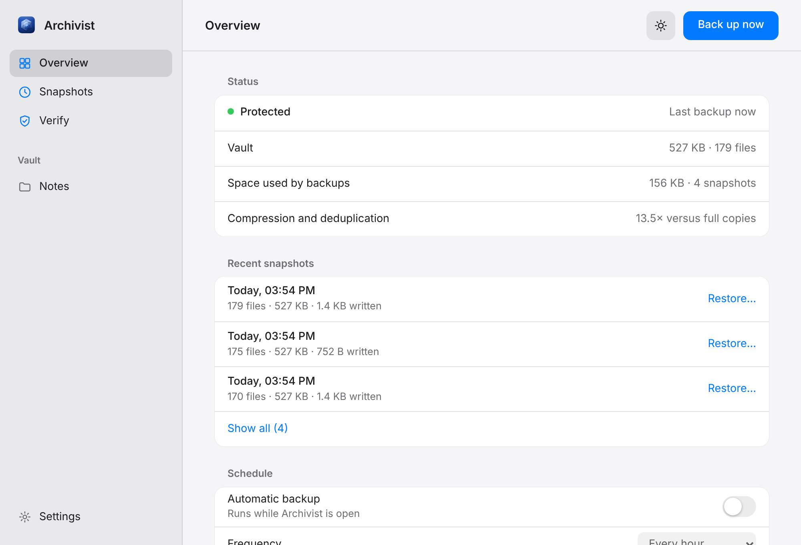

<div align="center">


# Archivist

*Fai il backup del tuo vault Obsidian. Ripristinalo byte per byte.*  
*Incrementale, deduplicato, lossless.*  

[English](README.md) · **Italiano** · [Sito](https://archivist.gusions.com) · [Download](https://github.com/Gusions/archivist/releases/latest)

[](Cargo.toml)
[](#aggiungere-una-lingua)
[](#piattaforme)
[](https://github.com/Gusions/archivist/actions/workflows/ci.yml)
[](https://github.com/Gusions/archivist/actions/workflows/release.yml)
[](LICENSE)
[](https://github.com/Gusions/archivist/stargazers)

Snapshot, non copie · lossless per costruzione · verifica integrità inclusa · niente cloud, niente account · traducibile

</div>

**Un vault cresce per anni. Archivist conserva ogni backup come snapshot completo, scrive solo ciò che è cambiato e non altera mai i tuoi file.**

| Cosa c'è nel vault | Cosa fa Archivist | Perdita di qualità |
|---|---|---|
| Note, testo, JSON, CSS | Deduplica a blocchi + compressione zstd | Nessuna |
| PNG, JPEG, WebP, PDF, audio, video | Salvati così come sono (già compressi) | Nessuna |
| Nota modificata (poche righe) | Scrive solo i blocchi cambiati, pochi KB | Nessuna |
| File spostato o duplicato | Zero spazio in più | Nessuna |

<p align="center"></p>

## Avvio rapido

```bash
cargo build --release --features window   # richiede Rust: https://rustup.rs
./target/release/archivist                # apre la finestra nativa
```

Nella finestra: scegli il vault (i vault Obsidian vengono rilevati da soli), scegli una cartella di backup (meglio su un altro disco), premi **Esegui backup**. Fine della configurazione.

Preferisci un'app già pronta? Scaricala da [Releases](../../releases): `Archivist-macOS-arm64.dmg` per Apple Silicon, più zip per macOS, Windows e Linux. Per creare il `.dmg` da solo su macOS esegui `./make-dmg.sh` (produce `dist/Archivist.app` e `dist/Archivist.dmg`).

> Se Gatekeeper blocca l'app al primo avvio: `xattr -d com.apple.quarantine <percorso>`

### Piattaforme

| Piattaforma | Finestra | Stato |
|---|---|---|
| macOS (arm64, x64) | WebKit (di sistema) | Compilato e testato da CI; `.dmg` arm64 in ogni release; app non notarizzata (vedi nota Gatekeeper) |
| Windows x64 | WebView2 (preinstallato su Win 10/11) | Compilato e testato da CI |
| Linux x64 | WebKitGTK | Compilato ed eseguito in CI e in sviluppo |

Nessun browser incluso: il binario pesa pochi MB.

## Funzioni

- **Snapshot incrementali**: ogni backup è una fotografia completa del vault.
- **Deduplica a blocchi** (FastCDC + BLAKE3).
- **Compressione lossless** (zstd) dove serve, nessuna dove non serve.
- **Ripristino esatto**: contenuto, date di modifica, cartelle vuote.
- **Cifratura** (opzionale, nei nuovi archivi): XChaCha20-Poly1305 con passphrase Argon2id; contenuti, nomi dei file e percorso del vault sono cifrati.
- **Verifica integrità**: rapida (tutti i blocchi presenti) o completa (rilegge e rifà l'hash di ogni blocco).
- **Retention**: ultimi N più giornalieri, settimanali, mensili. Lo snapshot più recente non viene mai eliminato.
- **Sfoglia e ripristina singoli file**: cerca in uno snapshot, vedi cosa è cambiato rispetto al precedente, ripristina un file o una cartella (app e CLI).
- **Export** di qualsiasi snapshot in un `.tar.zst` portabile.
- **Backup in background** su macOS e password nel Portachiavi.
- **Interfaccia nativa in stile macOS** con tema chiaro, scuro e di sistema.
- **Traducibile**: ogni stringa sta in `i18n/<codice>.json` (inglese e italiano inclusi).

## Come funziona

```
file del vault
   |  tagliati in blocchi da ~64 KB (FastCDC)
   v
hash BLAKE3 per blocco ---- già salvato? ---- sì --> solo riferimento
   |  no
   v
compressione zstd (saltata per i tipi incomprimibili)
   v
aggiunto a un pack (~64 MB)  -->  snapshot scritto per ultimo = visibile solo se completo
```

| Comando | Cosa fa |
|---|---|
| `archivist init --encrypt` | Crea un archivio cifrato (chiede una password) |
| `archivist copy <dest> [--encrypt]` | Copia tutti gli snapshot in un altro archivio (ricodificando ogni blocco). Con `--encrypt` crea un archivio cifrato da uno in chiaro; ricopiando si aggiungono solo i nuovi snapshot |
| `archivist passwd` | Cambia la password (i dati non vengono riscritti) |
| `archivist backup` | Crea uno snapshot |
| `archivist list` / `stats` | Elenca gli snapshot / mostra dimensioni e rapporto |
| `archivist verify [--full]` | Controlla l'integrità |
| `archivist restore <id\|latest> <cartella> [--path P]...` | Ripristina in una cartella vuota o nuova; `--path` ripristina solo quei file o cartelle |
| `archivist files <id\|latest> [--grep TESTO]` | Elenca i file di uno snapshot |
| `archivist diff [vecchio] [nuovo]` | Mostra file aggiunti, modificati e rimossi fra due snapshot |
| `archivist export <id\|latest> <file>` | Esporta come `.tar.zst` |
| `archivist prune` | Applica la retention |
| `archivist forget <id>` | Elimina uno snapshot e libera lo spazio non referenziato |
| `archivist schedule install\|status\|remove` | Backup in background (agente launchd su macOS) |
| `archivist keychain save\|forget` | Ricorda o dimentica la password dell'archivio nel Portachiavi (macOS) |
| `archivist window` | Apre la finestra nativa (build con `--features window`) |
| `archivist ui` | Interfaccia web locale nel browser invece della finestra |

```bash
archivist --repo /Volumes/Disco/ObsidianBackup backup --vault ~/Documents/MioVault
archivist restore latest ~/Desktop/Ripristino
```

Le impostazioni (vault, cartella archivio, esclusioni, retention, tema, lingua) si salvano dall'interfaccia in `~/Library/Application Support/Archivist/settings.json` (macOS) o `%APPDATA%\Archivist\settings.json` (Windows); la CLI le usa come default.

## Garanzie

- Uno snapshot compare solo a scrittura completata. Un backup interrotto lascia al massimo dati orfani, ripuliti dalla prossima `prune`/`forget`. I backup precedenti non vengono mai modificati.
- L'interfaccia locale ascolta solo su `127.0.0.1`, richiede un token casuale per ogni chiamata e rifiuta Host non locali (anti DNS-rebinding).
- Il ripristino rifiuta percorsi con `..` e cartelle di destinazione non vuote.
- Ripristino ed export rifanno l'hash di ogni blocco letto: un archivio danneggiato dà un errore chiaro invece di produrre file sbagliati in silenzio.
- Le scritture nell'archivio sono durevoli e atomiche, con lock a heartbeat; test di crash e di andata e ritorno girano in CI su Linux, macOS e Windows.

## Backup in background

- **macOS**: `archivist schedule install --every 60` (oppure Impostazioni, Backup, "Backup in background") installa un agente launchd dell'utente che esegue `archivist backup` ogni N minuti, anche con l'app chiusa. Log: `~/Library/Logs/Archivist/backup.log`. `archivist schedule status` mostra se è attivo e l'ultima riga del log; `archivist schedule remove` lo disattiva. L'agente punta al programma che l'ha installato: se sposti o elimini l'app, reinstallalo. La prima volta macOS può chiedere di consentire l'accesso alla cartella del vault (Documenti, iCloud Drive…); se non lo chiede, il log mostrerà un errore di permessi.
- **Archivi cifrati**: serve la password nel Portachiavi: `archivist keychain save` oppure spunta "Ricorda nel Portachiavi" quando crei o sblocchi l'archivio. `archivist keychain forget` la rimuove.
- **Windows**: `schtasks /Create /SC HOURLY /TN "Archivist" /TR "C:\\percorso\\archivist.exe backup"`. **Linux**: un timer systemd utente o cron che esegue `archivist backup`. Non ancora automatizzati; per gli archivi cifrati usa `ARCHIVIST_PASSWORD_FILE`.
- Il backup automatico dentro l'app (Impostazioni, Backup) funziona solo ad app aperta.
- `ARCHIVIST_CONFIG_DIR` indica un'altra cartella delle impostazioni (profili separati); un agente installato con quella variabile continua a usarla.

## Aggiungere una lingua

Copia `i18n/en.json` in `i18n/xx.json`, traduci i valori (mantieni i `{segnaposto}`), poi aggiungi una riga a `CATALOGS` in `src/i18n.rs`. Le chiavi mancanti ricadono sull'inglese. Lingua e tema (Sistema / Chiaro / Scuro) si scelgono da Impostazioni, Generale.

## Sviluppo

```bash
cargo test                                  # test del motore
cargo build --release --features window     # build con finestra nativa
```

Struttura: `src/repo.rs` (formato dell'archivio), `src/backend.rs` (backend di storage), `src/crypto.rs` (cifratura), `src/backup.rs` (chunking e snapshot), `src/copy.rs` (copia e cifratura di un archivio), `src/ops.rs` (ripristino, export, verifica, retention), `src/schedule.rs` e `src/keychain.rs` (backup in background, Portachiavi), `src/server.rs` (API locale), `src/window.rs` (finestra nativa e menu), `ui/index.html` (interfaccia), `i18n/` (stringhe).

## FAQ

**Sostituisce Time Machine o la sincronizzazione cloud?**
No. Protegge una cosa sola, un vault Obsidian, con storico e controlli di integrità. Tieni gli altri backup.

**Riduce le mie immagini?**
No, ed è voluto. Foto e PDF sono già compressi, quindi vengono salvati invariati. Risparmi spazio su testo, contenuti ripetuti e storico, non sui media.

**L'archivio è cifrato?**
Opzionalmente. `archivist init --encrypt` crea un archivio cifrato (XChaCha20-Poly1305, chiave dalla password con Argon2id); contenuti, nomi dei file e percorso del vault sono cifrati. Non sono nascosti numero e date degli snapshot e le dimensioni dei blocchi. **Se perdi la password i dati non sono recuperabili.** Puoi creare, sbloccare e cambiare la password anche dall'app (Impostazioni, Cifratura). Per cifrare un archivio in chiaro esistente usa Impostazioni → Cifratura → "Crea copia cifrata" oppure `archivist copy <nuova-cartella> --encrypt`: tutti gli snapshot vengono copiati in un nuovo archivio cifrato e l'originale resta intatto. Negli script usa `ARCHIVIST_PASSWORD` o `ARCHIVIST_PASSWORD_FILE`.

**Cosa non viene conservato?**
I link simbolici vengono ignorati; permessi Unix e attributi estesi non sono salvati (le date di modifica sì).

**Due computer possono scrivere sullo stesso archivio?**
Non contemporaneamente. Il lock è locale, non di rete.

**Vault con `.git`?**
Viene incluso come ogni altra cartella. Aggiungi `.git` alle esclusioni se non lo vuoi.

## Contribuire

Issue e pull request sono benvenute, soprattutto traduzioni e test sulle piattaforme.

## Licenza

[MIT](LICENSE)
