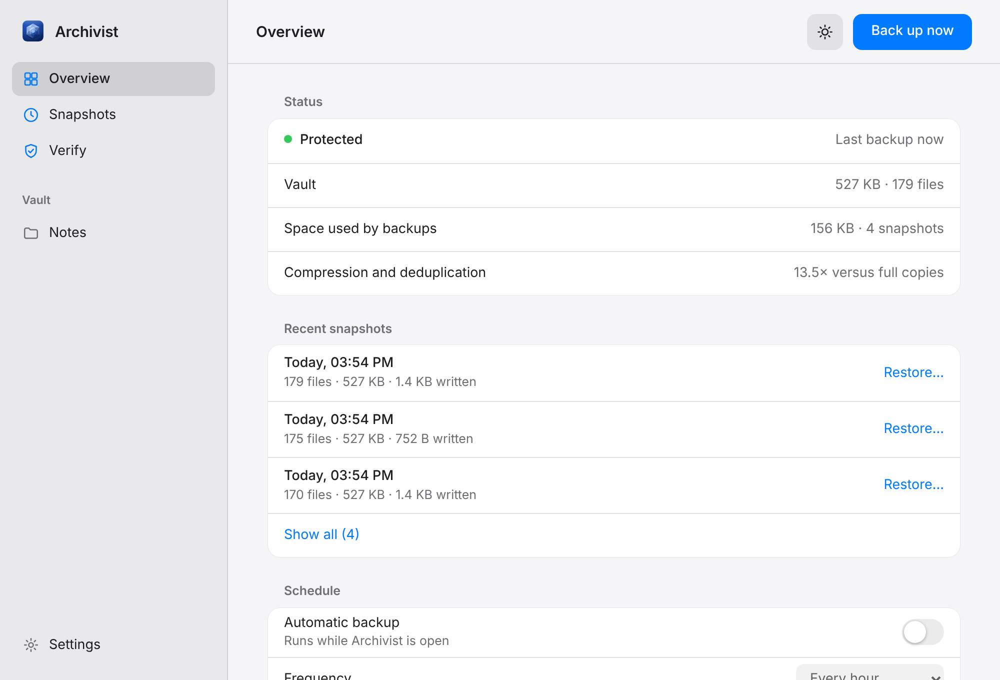
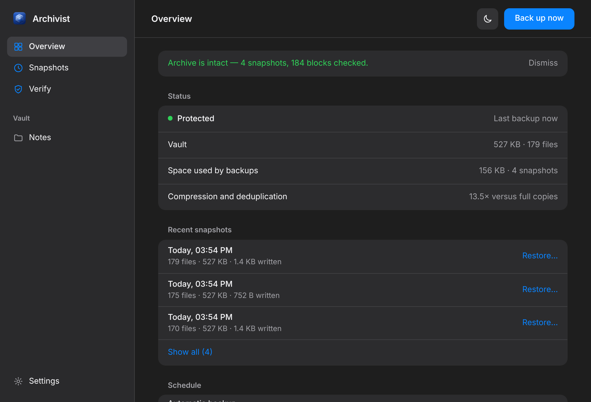
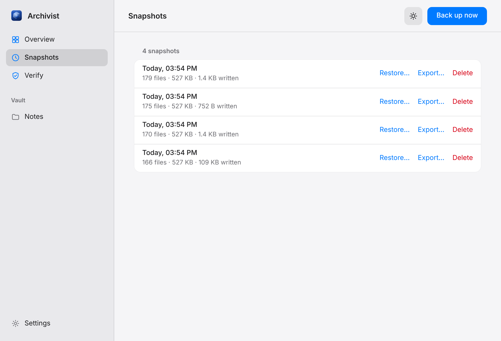
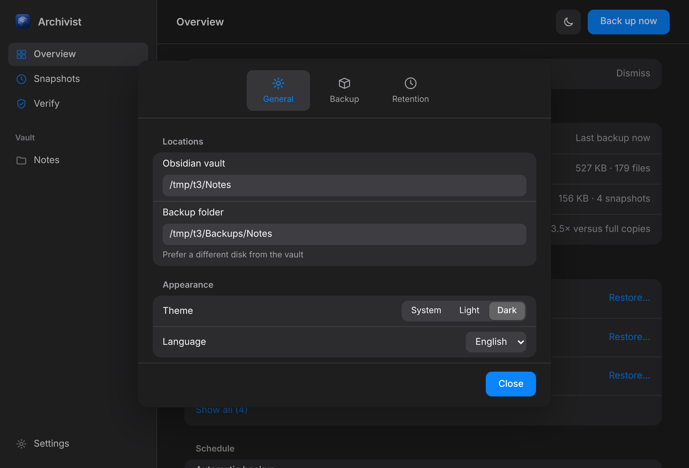

# Archivist

**English** · [Italiano](README.it.md)

Lossless, incremental, deduplicated backup and restore for [Obsidian](https://obsidian.md) vaults.
One small Rust binary, a native window, no cloud, no account.

<p align="center">
  
  
</p>

## Why

A vault grows for years, and copying it whole every time gets slow and expensive. Archivist keeps every backup as a full snapshot but stores only what changed, and it never degrades your files: restores are byte-identical.

## Features

- **Incremental snapshots**: each backup is a complete picture of the vault, yet only new data is written.
- **Block-level deduplication** (FastCDC + BLAKE3): editing a few lines costs a few KB, and moved or duplicated files take no extra space.
- **Lossless compression** (zstd) for text. Already-compressed files (images, PDFs, audio, video) are stored as they are: no quality loss, no wasted time.
- **Exact restore**: contents, modification times and empty folders.
- **Integrity checks**: quick (all blocks present) or full (re-read and re-hash every block).
- **Retention policy**: keep the latest N plus daily, weekly and monthly snapshots. The newest snapshot is never deleted.
- **Export** any snapshot as a single portable `.tar.zst`.
- **Native macOS-style UI**, light / dark / system theme, auto-detects your vaults from Obsidian's config.
- **Translatable**: every string lives in `i18n/<code>.json` (English and Italian included).

<p align="center">
  
  
</p>

## Install

Download a build from the [Releases](../../releases) page (macOS arm64 / x64, Windows x64, Linux x64), or build it yourself:

```bash
cargo build --release --features window   # needs Rust: https://rustup.rs
./target/release/archivist                # opens the native window
```

The window uses the system web view (WebKit on macOS, WebView2 on Windows, WebKitGTK on Linux): no bundled browser, a binary of a few MB. On macOS, `./make-dmg.sh` produces `dist/Archivist.app` and `dist/Archivist.dmg`.

If Gatekeeper blocks the app on first launch: `xattr -d com.apple.quarantine <path>`.

## Command line

```bash
archivist --repo /Volumes/Disk/ObsidianBackup backup --vault ~/Documents/MyVault
archivist list
archivist stats
archivist verify --full
archivist restore latest ~/Desktop/Restore    # destination must be empty or new
archivist export latest ~/Desktop/vault.tar.zst
archivist prune                               # apply the retention policy
archivist ui                                  # local web UI in the browser instead of the window
```

Settings (vault, archive folder, exclusions, retention, theme, language) are saved from the UI to `~/Library/Application Support/Archivist/settings.json` on macOS or `%APPDATA%\Archivist\settings.json` on Windows, and the CLI uses them as defaults.

## Background backups

The in-app schedule only runs while Archivist is open. For true background runs use the OS scheduler, e.g. on macOS a LaunchAgent at `~/Library/LaunchAgents/it.archivist.backup.plist` running `archivist backup` every hour, or on Windows `schtasks /Create /SC HOURLY /TN "Archivist" /TR "C:\path\archivist.exe backup"`. A ready-made plist is in [README.it.md](README.it.md#backup-in-background).

## How it works, and what it guarantees

- Files are split into ~64 KB content-defined chunks. Each chunk is identified by its BLAKE3 hash and stored once (zstd-compressed) in ~64 MB pack files.
- A snapshot becomes visible only after it is fully written. An interrupted backup leaves at most orphaned data, cleaned up by the next `prune`. Earlier backups are never modified.
- The local UI listens on `127.0.0.1` only, requires a random token on every call and rejects non-local `Host` headers (DNS-rebinding defense).
- Restore rejects paths containing `..` and non-empty destinations.

## Known limitations (v0.1)

- **No encryption yet**: the archive is stored in the clear. If it holds sensitive data, keep it on an encrypted volume (FileVault, BitLocker, VeraCrypt).
- Symlinks are skipped; Unix permissions and extended attributes are not preserved (modification times are).
- Don't write to the same archive from several machines at once (the lock is local, not network-wide).
- macOS-specific code (menu bar, `.dmg` script) is written against the platform APIs but has had less testing than the Linux build.

## Adding a language

Copy `i18n/en.json` to `i18n/xx.json`, translate the values (keep the `{placeholders}`), then add one line to `CATALOGS` in `src/i18n.rs`. Missing keys fall back to English.

## License

[MIT](LICENSE)
